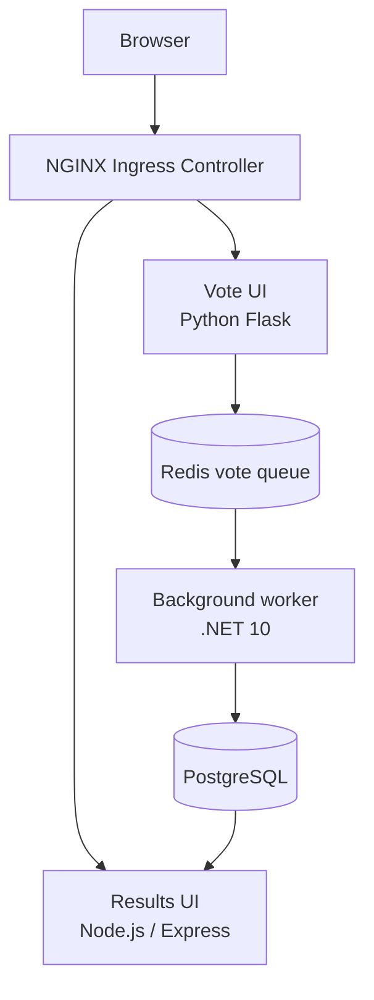

# Multi-Stack Voting Application on Amazon EKS

A multi-service voting application used to practise Docker, Kubernetes, Amazon EKS, NGINX Ingress, and GitHub Actions CI/CD. The application consists of a Python Flask voting UI, a Redis vote queue, a .NET worker, PostgreSQL, and a Node.js/Express results UI.

> **Project status:** The application was deployed to EKS, the Vote and Result interfaces were accessed through the NGINX Ingress LoadBalancer, GitHub Actions was used to build and deploy versioned Docker images, and an end-to-end vote was verified by observing the result count change.
>
> This is a learning project, not a fully production-hardened service. The current ingress uses HTTP; HTTPS/TLS is not configured.

## Contents

- [Architecture](#architecture)
- [Technology stack](#technology-stack)
- [Repository structure](#repository-structure)
- [Run locally with Docker Compose](#run-locally-with-docker-compose)
- [Deploy to Amazon EKS](#deploy-to-amazon-eks)
- [Access the application](#access-the-application)
- [GitHub Actions CI/CD](#github-actions-cicd)
- [Validation and troubleshooting](#validation-and-troubleshooting)
- [Security and cost notes](#security-and-cost-notes)

## Architecture



The data flow is:

1. A user submits a vote through the Vote application.
2. Vote data is queued in Redis.
3. The .NET Worker reads the queued votes and writes them to PostgreSQL.
4. The Result application reads the stored counts and displays the results.

## Technology stack

| Area | Technology |
|---|---|
| Cloud | AWS |
| Kubernetes | Amazon EKS, `eksctl`, `kubectl` |
| Container runtime/build | Docker and Docker Buildx |
| Image registry | Docker Hub |
| Ingress | NGINX Ingress Controller installed using Helm |
| CI/CD | GitHub Actions |
| Vote service | Python, Flask, Gunicorn |
| Result service | Node.js, Express, Socket.IO |
| Worker | .NET 10 |
| Vote queue | Redis |
| Database | PostgreSQL |
| Persistent storage | Kubernetes PVC backed by AWS storage |

## Repository structure

```text
.
├── .github/
│   └── workflows/
│       └── deploy.yml       # GitHub Actions build and deployment pipeline
├── k8s/
│   ├── ingress.yaml        # Routes /vote and /result through NGINX
│   ├── postgres.yaml       # PostgreSQL Deployment, Service and PVC
│   ├── redis.yaml          # Redis Deployment and Service
│   ├── result.yaml         # Result Deployment and Service
│   ├── vote.yaml           # Vote Deployment and Service
│   └── worker.yaml         # Background Worker Deployment
├── result/                 # Node.js/Express results application
├── vote/                   # Python/Flask voting application
├── worker/                 # .NET worker application
├── cluster.yaml            # eksctl cluster/add-on configuration
├── docker-compose.yml      # Local multi-container setup
└── README.md
```

The Worker is a background consumer and does not require an inbound Kubernetes Service. Redis and PostgreSQL are exposed inside the cluster through the `redis` and `db` Services; applications should use these DNS names rather than hard-coded Pod IP addresses.

## Run locally with Docker Compose

### Prerequisites

- Docker Engine with Docker Compose
- Git, if cloning the repository

Clone the repository and enter the project directory:

```bash
git clone https://github.com/mavanirahul1996/voting_app.git
cd voting_app
```

Create a `.env` file in the project root and set a local database password:

```dotenv
DB_PASSWORD=replace-with-a-local-password
```

Do not commit `.env` or real credentials to Git. Start the stack:

```bash
docker compose up --build
```

Open the local interfaces:

- Vote: <http://localhost:8080>
- Result: <http://localhost:8081>

Stop the containers with `Ctrl+C`, or run `docker compose down`. **Do not use `docker compose down -v` unless you intend to delete the local database volume and its stored data.**

## Deploy to Amazon EKS

The deployed cluster used in this project is named `voting-app-eks` in `us-east-1`. Provisioning a new EKS cluster can incur AWS charges. Do not create a second cluster if the existing one is already available.

### 1. Configure access to the existing cluster

Prerequisites include AWS CLI credentials with appropriate permissions, `kubectl`, and `eksctl`.

```bash
aws eks update-kubeconfig \
  --region us-east-1 \
  --name voting-app-eks

kubectl get nodes
```

### 2. Check the PostgreSQL Secret

The PostgreSQL Deployment expects a Kubernetes Secret named `postgres-secret` with a key named `POSTGRES_PASSWORD`. The Secret must exist in the same namespace as the application resources. Do not put the actual password in a committed YAML file.

Check that the Secret exists without displaying its value:

```bash
kubectl get secret postgres-secret
```

If it is missing, create it interactively or through your approved secret-management process. For example, enter the database password when prompted (the password is not printed):

```bash
read -rsp 'PostgreSQL password: ' DB_PASSWORD; echo
kubectl create secret generic postgres-secret \
  --from-literal=POSTGRES_PASSWORD="$DB_PASSWORD" \
  --dry-run=client -o yaml | kubectl apply -f -
unset DB_PASSWORD
```

Use the same password configured for PostgreSQL. Avoid saving it in shell history, terminal logs, or Git.

### 3. Apply the Kubernetes manifests

From the repository root:

```bash
kubectl apply -f k8s/
```

Check Pods, Deployments, Services, and Ingress:

```bash
kubectl get pods
kubectl get deployments
kubectl get services
kubectl get ingress
```

PostgreSQL persistence is defined through a PVC in `k8s/postgres.yaml`. The cluster needs a suitable storage provisioner and permissions for the PVC to become `Bound`.

### 4. Install NGINX Ingress Controller (if not already installed)

The controller was installed using Helm. Run these commands only if it is not already installed:

```bash
helm repo add ingress-nginx https://kubernetes.github.io/ingress-nginx
helm repo update
helm upgrade --install ingress-nginx ingress-nginx/ingress-nginx \
  --namespace ingress-nginx \
  --create-namespace \
  --set controller.service.type=LoadBalancer
```

An AWS LoadBalancer is provisioned for the controller Service. Creating and keeping this LoadBalancer can incur charges.

## Access the application

Get the current public LoadBalancer hostname:

```bash
kubectl get service ingress-nginx-controller -n ingress-nginx
```

Use the hostname shown in the `EXTERNAL-IP` column:

- Vote UI: `http://<LOAD_BALANCER_HOST>/vote`
- Result UI: `http://<LOAD_BALANCER_HOST>/result`

The hostname is assigned by AWS and may change if the LoadBalancer is recreated. These endpoints currently use HTTP only; no TLS certificate or HTTPS listener has been configured.

## GitHub Actions CI/CD

Workflow file: `.github/workflows/deploy.yml`.

The workflow is configured to run on pushes to `main` and can also be started manually. It:

1. Checks out the source repository.
2. Configures Docker Buildx and logs in to Docker Hub.
3. Builds the `vote`, `result`, and `worker` images for `linux/amd64`.
4. Pushes each image to Docker Hub with both `latest` and the Git commit SHA as tags.
5. Configures AWS credentials and updates the runner's kubeconfig for EKS.
6. Applies the Kubernetes manifests in `k8s/`.
7. Updates the three application Deployments to use the new commit-SHA image tags.
8. Waits for the Vote, Result, and Worker rollouts to complete.

### Configure repository secrets

In GitHub, open **Settings → Secrets and variables → Actions** for this repository and configure:

| Secret | Purpose |
|---|---|
| `DOCKERHUB_USERNAME` | Docker Hub account username |
| `DOCKERHUB_TOKEN` | Docker Hub access token with the required push permissions |
| `AWS_ACCESS_KEY_ID` | IAM access key used by the workflow |
| `AWS_SECRET_ACCESS_KEY` | Matching IAM secret access key |

Never put credentials directly in workflow YAML. Use a dedicated, least-privilege IAM identity; GitHub OIDC with an IAM role is a recommended hardening improvement over long-lived AWS access keys. The IAM identity must have permission to update EKS kubeconfig and be authorized to access the Kubernetes cluster.

After pushing a change to `main`, review the run under the repository's **Actions** tab. A successful workflow run should show all build/push steps and deployment rollout checks as successful.

## Validation and troubleshooting

### Check cluster health

```bash
kubectl get nodes
kubectl get pods
kubectl get deployments
kubectl get services
kubectl get ingress
```

The application Pods should be `Running`, and the `vote`, `result`, and `worker` Deployments should report the expected replicas as `Available`.

### Check application logs

```bash
kubectl logs deployment/vote --tail=100
kubectl logs deployment/result --tail=100
kubectl logs deployment/worker --tail=100
```

### Check rollout status

```bash
kubectl rollout status deployment/vote --timeout=180s
kubectl rollout status deployment/result --timeout=180s
kubectl rollout status deployment/worker --timeout=180s
```

### End-to-end test

1. Open `/vote` and submit a vote.
2. Open `/result` and confirm the corresponding count changes.
3. If the count does not change, check the Vote logs, Worker logs, PostgreSQL Pod/PVC, and the Result browser console.
4. Check that the Result app's Socket.IO polling endpoint responds at `/result/socket.io/?EIO=4&transport=polling`. A successful handshake returns HTTP `200` and a Socket.IO session response.

### Common issues

- **Pod `ImagePullBackOff`:** check the image name/tag and Docker Hub access.
- **Pod `CrashLoopBackOff`:** inspect `kubectl logs <pod-name> --previous` and `kubectl describe pod <pod-name>`.
- **PVC not `Bound`:** check the EBS CSI add-on, StorageClass, IAM permissions, and PVC events.
- **Ingress address pending:** inspect the controller Service and events with `kubectl describe service ingress-nginx-controller -n ingress-nginx`.
- **UI styling or white screen:** use browser Developer Tools → Network and Console to identify missing CSS/JavaScript or Socket.IO connection errors.
- **CI/CD deployment failure:** inspect the failed step in GitHub Actions and verify repository secrets, IAM/EKS permissions, and the cluster name/region.

## Security and cost notes

- Keep passwords, tokens, AWS keys, and `.env` files out of Git.
- PostgreSQL access is intended to be internal to the Kubernetes cluster.
- This learning deployment does not configure HTTPS/TLS, a production secret manager, autoscaling policies, resource limits, comprehensive monitoring, or a production-grade database backup/restore process.
- EKS, EC2 worker nodes, EBS volumes, and AWS LoadBalancers can incur charges while provisioned. Check current resources and costs when the demo is complete.
- Only delete the cluster after confirming you no longer need it and that any data you want to keep has been backed up. Deleting the cluster can remove workloads and may permanently remove stored application data.
